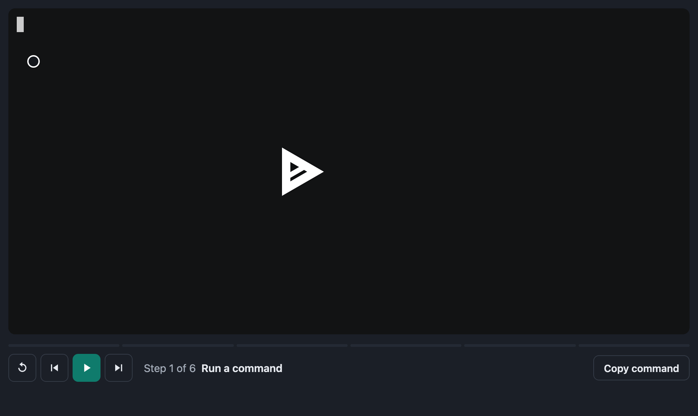

# CLIscenes

CLIscenes turns plain YAML files into interactive walkthroughs of developer workflows that move between a terminal and another app, such as a CLI sign-in that you approve in a desktop app.

The terminal shows commands and output as real text that readers can select and copy. Approval prompts and screenshots appear at the right moment, with short notes that explain each step. When a step needs the reader to act, the walkthrough waits until they do.

> **Status:** early release (v0). The format and APIs may change.

In this example, YourApp's Touch ID prompt appears over the terminal. The walkthrough waits until the reader touches the sensor, and takes a different path if they select **Cancel**.

[](https://libutcher.github.io/CLIscenes/?demo=figma-touch-id)

**[Try the walkthroughs yourself](https://libutcher.github.io/CLIscenes/)** — GitHub can't run the player inside a README, so each recording below links to the live version, where the buttons really work.

## The problem

Some CLI workflows don't stay in the terminal, which makes them hard to show from start to finish without a screen recording. For example:

1. You run a CLI command.
2. A desktop app asks you to approve the request.
3. You approve it, and the CLI continues.

Seeing screens like these approval prompts helps readers understand how the tool works, and keeps them from getting lost during setup.

Docs usually show this flow with code blocks, screenshots, videos, and prose. Readers struggle to follow these as one flow. Writers struggle to keep them up to date. A terminal replay can't show the dialog the reader clicks. A video shows everything, but readers can't copy its text. Each product change also means a new video.

## Features

- **Timeline.** The terminal and the other apps stay in step, so the reader can see what happens at each point.
- **Gates.** The walkthrough stops where the real CLI waits. The reader selects **Approve** or **Deny** to continue.
- **Real text.** Readers can select and copy terminal text. A **Copy command** button copies the current command.
- **Docs as code.** Writers describe steps, commands, output, and apps in YAML or JSON. CLIscenes works out the timing. Error messages name the exact field to fix.
- **Your own designs.** Show your app's real prompt as an image, such as a Touch ID request. Readers click the buttons it shows, and it can animate. Place each button by measuring it, or by naming its layer in the design so that a design change moves the button and its click area together. See [Images](#images-a-screenshot-to-read-or-a-design-to-click).
- **Clearly practice.** Each app window, and each image shown as a dialog, carries a "Simulated" label. Nothing in a walkthrough runs commands or approves real requests.
- **Static output.** CLIscenes builds a small web player that you can host anywhere and embed in any docs site.

CLIscenes uses [asciinema-player](https://github.com/asciinema/asciinema-player) to show the terminal.

## Quick start 🚀

### Requirements

- Node.js 20.19 or later.

### Run CLIscenes locally

Clone the repository, install its dependencies, and start the local player:

```sh
git clone https://github.com/libutcher/CLIscenes.git
cd CLIscenes
npm install
npm run dev
```

Open the URL that `npm run dev` prints, usually http://localhost:5173. You should see the example walkthroughs. The page updates each time you save a file in `demos/`.

You can use these commands from the repository folder:

| Command | What it does |
| --- | --- |
| `npm run dev` | Starts the local player and updates it when files change |
| `npm run validate` | Checks every walkthrough file for errors |
| `npm run generate` | Writes the walkthrough files to `generated/demos/` |
| `npm run build` | Builds the static site in `dist/` |
| `npm run preview` | Serves `dist/` on your computer |
| `npm run figma` | Downloads images linked to Figma frames into `demos/` (needs `FIGMA_TOKEN`) |
| `npm test` | Runs the unit tests |
| `npm run test:e2e` | Runs the browser tests (first run `npx playwright install chromium`) |
| `npm run typecheck` | Checks the TypeScript code |
| `npm run check` | Runs the type check, unit tests, and build |
| `npm run gifs` | Records the demo GIFs in `docs/media/` (add file names, such as `-- non-interactive.gif`, to record only those) |
| `npm run build:lib` | Builds the React and Docusaurus components and the `cliscenes` command into `dist-lib/` |

To create or change a walkthrough, edit its YAML file in `demos/`. An AI assistant can write the file for you (see [AI assistants](#ai-assistants)).

## Example

This example is a shortened version of `demos/cli-signin.yaml`. The `your-cli` command and the YourApp desktop app are fictional.

```yaml
title: Sign in to a CLI with a desktop app

steps:
  - id: signin
    title: Run a command
    terminal:
      command: your-cli signin
      output: Waiting for approval in YourApp...

  - id: approve
    title: Approve the sign-in request
    overlay:
      type: auth-prompt
      app: YourApp
      title: Allow CLI sign-in?
      message: Terminal is running "your-cli signin" and wants to access your account.
      actions:
        - label: Approve
          next: success
        - label: Deny
          style: secondary
          next: denied
    waitForAction: true        # the walkthrough waits here for the reader

  - id: success
    title: Sign-in succeeds
    terminal:
      output: Signed in as demo@example.com

  - id: list-projects
    title: Run an authenticated command
    terminal:
      command: your-cli projects list
      output: |
        ID        NAME
        prj_001   Website
    finish: true               # the main path ends here

  - id: denied
    title: If you deny the request
    terminal:
      clear: true
      output: "Error: sign-in request was denied in the desktop app."
```

To add a walkthrough, create a `.yaml` file in `demos/`. The file name becomes the walkthrough's id, as in `?demo=<file-name>`.

`demos/` has four examples:

- **`cli-signin`:** an interactive prompt that waits for the reader to select **Approve** or **Deny**.
- **`touch-id-signin`:** a Touch ID prompt shown as an image, with each click area measured as a percentage. The reader touches the sensor to approve, which plays an animation, or selects **Cancel**. [Show a dialog as an image](docs/authoring.md#show-a-dialog-as-an-image) explains how it's built.
- **`figma-touch-id`:** the same flow, with each button placed by the name of its layer in the design. See [Images](#images-a-screenshot-to-read-or-a-design-to-click).
- **`static-screenshot`:** a single path with a screenshot the reader only looks at, and no waiting.

[docs/authoring.md](docs/authoring.md) describes the full format.

## Overlay types

An overlay shows an app or note outside the terminal.

| Type | Shows | Can wait for the reader |
| --- | --- | --- |
| `auth-prompt` | An app's request for approval | Yes |
| `app-window` | A simple app window with text and buttons | Yes |
| `image` | A screenshot, illustration, or an app's real prompt, optionally animated and kept in step with a design | Yes, through clickable areas over its buttons |
| `annotation` | A short note | No |

[docs/architecture.md](docs/architecture.md#adding-an-overlay-type) explains how to add a type.

## Images: a screenshot to read, or a design to click

An `image` overlay does two jobs, and the difference is whether it has `actions`.

### A static screenshot, on one path

With no `actions`, the image is shown for the step's `pause` and the walkthrough moves on. Nothing waits, so the walkthrough has one path from start to finish. Use it for a settings pane, a confirmation, or anything the reader only needs to see.

```yaml
- id: setting
  title: Turn on CLI integration
  overlay:
    type: image
    src: assets/cli-settings.svg
    caption: YourApp > Settings > Developer
    alt: YourApp settings, Developer section. CLI integration is turned on.
  pause: 2.5                       # seconds on screen, then the next step
```

[](https://libutcher.github.io/CLIscenes/?demo=static-screenshot)

That image needs nothing else: no layer names, no positions file, no Figma link, and no clicks from the reader. [Play it live](https://libutcher.github.io/CLIscenes/?demo=static-screenshot), or run `npm run dev` and open **Turn on CLI access in the desktop app** ([`demos/static-screenshot.yaml`](demos/static-screenshot.yaml)).

### A design the reader clicks, with more than one path

Add `actions` and `waitForAction: true`, and the walkthrough stops until the reader chooses. Each action's `next` sends that choice to a different step, which is how a walkthrough branches. Place each button by the name of its layer in the design:

```yaml
- id: touch-id
  title: Touch the sensor to approve
  overlay:
    type: image
    src: assets/figma-touch-id/prompt.svg
    frame: false                   # it's already a dialog, so no card around it
    figma: https://www.figma.com/design/AbC123/Prompts?node-id=12-34
    alt: YourApp asks to confirm the sign-in, using Touch ID or a password.
    actions:
      - label: Approve with Touch ID
        layer: fingerprint         # the layer's name in the design
      - label: Cancel
        style: secondary
        layer: cancel
        next: cancelled            # a second path
  waitForAction: true
```

Each `layer` is looked up in a positions file beside the image, `prompt.layers.json`, which holds each layer's box in the image's own pixels. The build reads that file, turns every `layer` into a position, and never contacts Figma.

There are two ways to get that file, and the YAML above is the same either way:

| | With Figma access | Without Figma access |
| --- | --- | --- |
| The `figma` link | Add it to the overlay | Leave it out |
| The positions file | `npm run figma` writes it, along with a fresh copy of the image | You write it once, by hand |
| After a design change | Run `npm run figma` again and the click areas follow the buttons | Update the numbers you changed |

A Figma personal access token (scope **File content: read**) in `FIGMA_TOKEN` is what `npm run figma` needs; it never goes into a file in the repository. [Writing a positions file by hand](docs/authoring.md#writing-a-positions-file-by-hand) covers the other column.

The GIF at the top of this README is the **Approve** path. Selecting **Cancel** takes the other one:

[](https://libutcher.github.io/CLIscenes/?demo=figma-touch-id)

[Click through it live](https://libutcher.github.io/CLIscenes/?demo=figma-touch-id), or run `npm run dev` and open **Sign in to a CLI with Touch ID, from a design** ([`demos/figma-touch-id.yaml`](demos/figma-touch-id.yaml)). Its positions file is hand-written, so the demo runs with no Figma account at all, and it places the buttons where `touch-id-signin` measured them by hand.

[Clickable images](docs/authoring.md#clickable-images) and [Click areas from layer names](docs/authoring.md#click-areas-from-layer-names) describe every field.

## Customization

You can match a walkthrough to your product without code changes:

- **Icon:** set `icon` on an `auth-prompt` to your app's icon.
- **Colors:** set `theme.accent` to your brand color. CLIscenes picks a readable text color for you.
- **Text:** set the app name, title, message, account, and button labels.
- **Your own design:** show your app's real prompt as an image, with an optional CSS animation, such as a Touch ID sensor reading a fingerprint. See [Images](#images-a-screenshot-to-read-or-a-design-to-click).

For example, to use your brand color:

```yaml
theme:
  accent: "#0f7b6c"
```

Use your own product's logo and colors, never another company's. [docs/authoring.md](docs/authoring.md#theme) covers themes in detail.

## AI assistants

A [skill file](.claude/skills/cliscenes-authoring/SKILL.md) tells AI assistants how to write walkthroughs. It covers the workflow, the choice of overlay and layout, and fixes for common errors.

- **Claude Code** loads the skill automatically. You can ask, for example, "Create a walkthrough that shows sign-in to our CLI."
- **Other assistants** find the skill through [AGENTS.md](AGENTS.md).
- **People** can read the skill as plain Markdown.

## Playback

The reader controls the walkthrough with Restart, Previous step, Play or Pause, and Next step. A step list lets the reader jump to any step.

When a step waits for the reader, its result doesn't appear until they act. The reader can still move freely:

- **Back:** the reader returns to a step, and that step asks for the action again.
- **Forward:** the reader skips a step that waits for an action, and the step list marks it "Skipped".

[docs/architecture.md](docs/architecture.md#gate-policy) describes these rules in full.

## Embeds

Run `npm run build`, then host the `dist/` folder on any static web server. Add the walkthrough to a page with an iframe:

```html
<iframe
  src="https://docs.example.com/cliscenes/?demo=cli-signin&embed=1"
  title="Interactive walkthrough: sign in to a CLI with a desktop app"
  loading="lazy"
  allow="clipboard-write"
  style="width: 100%; height: 560px; border: 0;"
></iframe>
```

- **Docusaurus:** add `<CLIscene walkthrough="cli-signin" />` to any MDX page. The native component needs no iframe and follows the site's light or dark mode. [docs/embedding.md](docs/embedding.md#docusaurus) shows the setup.
- **Minimal by default:** embeds show the terminal, the app UI, and the controls. Your page supplies the title and introduction. Add `header` or `steps` (or `&header=1`, `&steps=1` on an iframe) to show more.
- **Mintlify:** copy the ready-made component from [`examples/mintlify/`](examples/mintlify/). The component matches the site's light or dark mode and sets the iframe height.
- **Other React sites:** import `CLIscene` from `cliscenes/react`.
- **Light or dark mode:** add `&theme=light` or `&theme=dark` to the URL.
- **Example page:** open `dist/embed-example.html` to see a live embed.

[docs/embedding.md](docs/embedding.md) covers other docs platforms.

## Accessibility

- **Controls:** each control is a button with a clear name and a visible focus ring.
- **Prompts:** each prompt is a labeled dialog. The terminal stays visible behind it.
- **Focus:** when a prompt appears, focus moves to its main button, but only if the reader is already using the walkthrough. This keeps the page from jumping while someone scrolls past it.
- **Announcements:** screen readers announce each new step and what the walkthrough waits for.
- **Images:** each image needs alt text.
- **Motion:** when the reader prefers reduced motion, commands appear whole, overlays appear without sliding in, and animated images are swapped for a version without movement.
- **Shortcuts:** the player has no single-key shortcuts, so it can't conflict with the page or assistive technology.

[docs/manual-testing.md](docs/manual-testing.md) lists the manual checks.

## Limitations

- **Authored output:** writers type all terminal output. CLIscenes never runs commands.
- **One terminal:** each walkthrough has one terminal, which plays from start to end. Branches are steps that the reader reaches through `next`.
- **One step per overlay:** an overlay appears in one step. To keep it on screen longer, repeat it in each step.
- **Click areas need upkeep:** if a design moves a button and the image's positions file isn't updated, the click area no longer lines up. `npm run figma` rewrites that file from the design; a hand-written one is edited by hand.
- **Image animations:** only SVG images can use an `animation` stylesheet. Use GIF or animated WebP for other images.
- **Figma downloads are manual:** run `npm run figma` to fetch the latest designs. Builds use the image files in the folder and never contact Figma, so a walkthrough builds offline and gives the same result every time.
- **Small screens:** wide terminals shrink on phones. Keep `cols` near 64 for phone readers.
- **Colors only:** themes change colors, not fonts or shapes.
- **Iframe in Mintlify:** the Mintlify snippet loads the player in an iframe, so you need to host the player separately.

## Roadmap

- **Recorded output:** import output from asciinema or VHS files.
- **Generated walkthroughs:** build walkthroughs from CLI help, tested examples, SDK comments, or tests.
- **Longer overlays:** keep one overlay on screen across several steps.
- **Native Mintlify component:** embed walkthroughs in Mintlify without an iframe.
- **More overlays:** add a browser window with an address bar and form fields.

[GitHub issues](https://github.com/libutcher/CLIscenes/issues) track each item.

## Project docs

- [docs/authoring.md](docs/authoring.md): the walkthrough format
- [docs/embedding.md](docs/embedding.md): static output and embeds
- [docs/architecture.md](docs/architecture.md): the design and gate rules
- [docs/adr/0001-terminal-player.md](docs/adr/0001-terminal-player.md): the choice of terminal player
- [docs/manual-testing.md](docs/manual-testing.md): the manual test checklist
- [AGENTS.md](AGENTS.md): notes for AI assistants
- [CONTRIBUTING.md](CONTRIBUTING.md): how to report problems and make changes

## License and attribution

CLIscenes uses the [MIT License](LICENSE).

The built player includes these packages:

| Package | License | Role |
| --- | --- | --- |
| [asciinema-player](https://github.com/asciinema/asciinema-player) | Apache-2.0 | Terminal playback |
| [solid-js](https://github.com/solidjs/solid) | MIT | Part of asciinema-player |
| [React](https://react.dev) and React DOM | MIT | Player interface |

The build process also uses [Vite](https://vite.dev) (MIT), [yaml](https://github.com/eemeli/yaml) (ISC), [zod](https://zod.dev) (MIT), [Vitest](https://vitest.dev) (MIT), [Playwright](https://playwright.dev) (Apache-2.0), [tsx](https://github.com/privatenumber/tsx) (MIT), and [TypeScript](https://www.typescriptlang.org) (Apache-2.0).

`npm run build` writes the license texts to `dist/THIRD_PARTY_LICENSES.txt`. Keep this file when you share a built player. The asciinema-player license requires it.

The examples use a fictional CLI and fictional apps.
