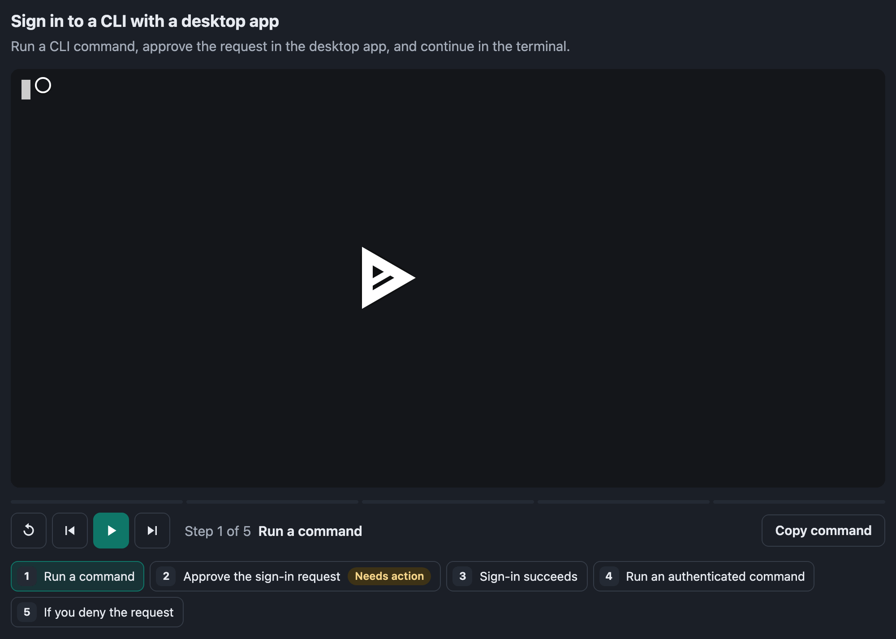

# CLIscenes

CLIscenes turns plain YAML files into interactive walkthroughs of developer workflows that involve a terminal interacting with another app.

The terminal shows commands and output as real text that readers can select and copy. Approval prompts and screenshots appear at the right moment in the flow, with supporting documentation. When a step needs the reader to act, the walkthrough waits until they do.

> **Status:** early release (v0). The format and APIs may change.

The app's prompt appears over the terminal, as an auth prompt would. The walkthrough waits to continue until the reader selects **Approve**, and shows an alternative path if they choose **Deny**.



## The problem

Some CLI workflows don't stay in the terminal, and as a result are difficult to visualize in end-to-end demos without requiring screen recordings. For example:

1. You run a CLI command.
2. A desktop app asks you to approve the request.
3. You approve it, and the CLI continues.

Being able to visualize screens like auth prompts helps the reader to understand how the tool works, and avoid getting confused during setup.

Docs usually show this flow with code blocks, screenshots, videos, and prose. Readers struggle to follow these as one flow. Writers struggle to keep them up to date. A terminal replay can't show the dialog the reader clicks. A video shows everything, but readers can't copy its text. Each product change also means a new video.

## Features

- **Timeline.** The terminal and the apps around it stay aligned, and the user can see which step happens when.
- **Gates.** The walkthrough stops where the real CLI waits. The reader selects **Approve** or **Deny** to continue.
- **Real text.** Readers can select and copy terminal text. A **Copy command** button copies the current command.
- **Docs as code.** Writers describe steps, commands, output, and apps in YAML or JSON. CLIscenes sets the delays. Error messages name the exact field to fix.
- **Clearly practice.** Each app window carries a "Simulated" label. Nothing in a walkthrough runs commands or approves real requests.
- **Static output.** CLIscenes builds a small web player that you can host anywhere and embed in any docs site.

CLIscenes uses [asciinema-player](https://github.com/asciinema/asciinema-player) to show the terminal.

## Quick start 🚀

### Requirements

- Node.js 20.19 or later.

### Install CLIscenes

To install the tool, open your project in the terminal and run:

```sh
npm install
npm run dev
```

Open the URL that the command prints, usually http://localhost:5173. The page updates each time you save a file in `demos/`.

| Command | What it does |
| --- | --- |
| `npm run dev` | Starts the local player and updates it when files change |
| `npm run validate` | Checks every walkthrough file for errors |
| `npm run generate` | Writes the walkthrough files to `generated/demos/` |
| `npm run build` | Builds the static site in `dist/` |
| `npm run preview` | Serves `dist/` on your computer |
| `npm test` | Runs the unit tests |
| `npm run test:e2e` | Runs the browser tests (first run `npx playwright install chromium`) |
| `npm run typecheck` | Checks the TypeScript code |
| `npm run check` | Runs the type check, unit tests, and build |
| `npm run gifs` | Records the demo GIFs in `docs/media/` |
| `npm run build:lib` | Builds the React and Docusaurus components and the `cliscenes` command into `dist-lib/` |

Currently, you need to edit a YAML file to use the code and app visualization you need. You can use the bundled skill to do this quickly with your AI agent.

## Example

This example is a shortened version of `demos/cli-signin.yaml`. The `your-cli` command and the YourApp desktop app are fictional.

```yaml
title: Sign in to a CLI with a desktop app

steps:
  - id: signin
    title: Run a command
    terminal:
      command: your-cli signin
      output: Waiting for approval in YourApp...

  - id: approve
    title: Approve the sign-in request
    overlay:
      type: auth-prompt
      app: YourApp
      title: Allow CLI sign-in?
      message: Terminal is running "your-cli signin" and wants to access your account.
      actions:
        - label: Approve
          next: success
        - label: Deny
          style: secondary
          next: denied
    waitForAction: true        # the walkthrough waits here for the reader

  - id: success
    title: Sign-in succeeds
    terminal:
      output: Signed in as demo@example.com

  - id: list-projects
    title: Run an authenticated command
    terminal:
      command: your-cli projects list
      output: |
        ID        NAME
        prj_001   Website
    finish: true               # the main path ends here

  - id: denied
    title: If you deny the request
    terminal:
      clear: true
      output: "Error: sign-in request was denied in the desktop app."
```

To add a walkthrough, create a `.yaml` file in `demos/`. The file name becomes the walkthrough's id, as in `?demo=<file-name>`.

[docs/authoring.md](docs/authoring.md) describes the full format.

## Static screenshot comparison (experimental)

The `cli-signin-screenshot` example demonstrates the same fictional sign-in flow with an **illustrative static image** of an authentication prompt rather than a clickable mock dialog. The screenshot's buttons do nothing; **Show expected result** appears separately in the player's controls. The existing `cli-signin` demo remains available for comparison.

This is intentionally not a real product screenshot; replace the example image with a genuine sanitized application capture when testing against a product. The image workflow does not require Figma. See [the authoring reference](docs/authoring.md#image).

## Overlay types

An overlay shows an app or note outside the terminal.

| Type | Shows | Can wait for the reader |
| --- | --- | --- |
| `auth-prompt` | An app's request for approval | Yes |
| `app-window` | A simple app window with text and buttons | Yes |
| `image` | A screenshot or illustration | No |
| `annotation` | A short note | No |

[docs/architecture.md](docs/architecture.md#adding-an-overlay-type) explains how to add a type.

## Customization

You can match a walkthrough to your product without code changes:

- **Icon:** set `icon` on an `auth-prompt` to your app's icon.
- **Colors:** set `theme.accent` to your brand color. CLIscenes picks a readable text color for you.
- **Text:** set the app name, title, message, account, and button labels.

```yaml
theme:
  accent: "#0f7b6c"
```

Use your own product's logo and colors, never another company's. [docs/authoring.md](docs/authoring.md#theme) covers themes in detail.

## AI assistants

A [skill file](.claude/skills/cliscenes-authoring/SKILL.md) tells AI assistants how to write walkthroughs. It covers the workflow, the choice of overlay and layout, and fixes for common errors.

- **Claude Code** loads the skill automatically. You can ask, for example, "Create a walkthrough that shows sign-in to our CLI."
- **Other assistants** find the skill through [AGENTS.md](AGENTS.md).
- **People** can read the skill as plain Markdown.

## Playback

The reader controls the walkthrough with Restart, Previous step, Play or Pause, and Next step. A step list lets the reader jump to any step.

The reader never sees a step's result before they complete its action. The reader can still move freely:

- **Back:** the reader returns to a step, and that step asks for the action again.
- **Forward:** the reader skips a step that waits for an action, and the step list marks it "Skipped".

[docs/architecture.md](docs/architecture.md#gate-policy) describes these rules in full.

## Embeds

Run `npm run build`, then host the `dist/` folder on any static web server. Add the walkthrough to a page with an iframe:

```html
<iframe
  src="https://docs.example.com/cliscenes/?demo=cli-signin&embed=1"
  title="Interactive walkthrough: sign in to a CLI with a desktop app"
  loading="lazy"
  allow="clipboard-write"
  style="width: 100%; height: 560px; border: 0;"
></iframe>
```

- **Docusaurus:** add `<CLIscene walkthrough="cli-signin" />` to any MDX page. The native component needs no iframe and follows the site's light or dark mode. [docs/embedding.md](docs/embedding.md#docusaurus) shows the setup.
- **Minimal by default:** embeds show the terminal, the app UI, and the controls. Your page supplies the title and introduction. Add `header` or `steps` (or `&header=1`, `&steps=1` on an iframe) to show more.
- **Mintlify:** copy the ready-made component from [`examples/mintlify/`](examples/mintlify/). The component matches the site's light or dark mode and sets the iframe height.
- **Other React sites:** import `CLIscene` from `cliscenes/react`.
- **Light or dark mode:** add `&theme=light` or `&theme=dark` to the URL.
- **Example page:** open `dist/embed-example.html` to see a live embed.

[docs/embedding.md](docs/embedding.md) covers other docs platforms.

## Accessibility

- **Controls:** each control is a button with a clear name and a visible focus ring.
- **Prompts:** each prompt is a labeled dialog. The terminal stays visible behind it.
- **Focus:** when a prompt appears, focus moves to its main button, but only if the reader already uses the walkthrough.
- **Announcements:** screen readers announce each new step and what the walkthrough waits for.
- **Images:** each image needs alt text.
- **Motion:** when the reader prefers reduced motion, commands appear whole and overlays don't animate.
- **Shortcuts:** the player has no single-key shortcuts, so it can't conflict with the page or assistive technology.

[docs/manual-testing.md](docs/manual-testing.md) lists the manual checks.

## Limitations

- **Authored output:** writers type all terminal output. CLIscenes never runs commands.
- **One terminal:** each walkthrough has one terminal, which plays from start to end. Branches are steps that the reader reaches through `next`.
- **One step per overlay:** an overlay appears in one step. To keep it on screen longer, repeat it in each step.
- **Small screens:** wide terminals shrink on phones. Keep `cols` near 64 for phone readers.
- **Colors only:** themes change colors, not fonts or shapes.
- **Iframe in Mintlify:** the Mintlify snippet embeds the hosted player in an iframe, so the player needs a host of its own.

## Roadmap

- **Recorded output:** import output from asciinema or VHS files.
- **Generated walkthroughs:** build walkthroughs from CLI help, tested examples, SDK comments, or tests.
- **Longer overlays:** keep one overlay on screen across several steps.
- **Native Mintlify component:** embed walkthroughs in Mintlify without an iframe.
- **More overlays:** add a browser window with an address bar and form fields.

[GitHub issues](https://github.com/libutcher/CLIscenes/issues) track each item.

## Project docs

- [docs/authoring.md](docs/authoring.md): the walkthrough format
- [docs/embedding.md](docs/embedding.md): static output and embeds
- [docs/architecture.md](docs/architecture.md): the design and gate rules
- [docs/adr/0001-terminal-player.md](docs/adr/0001-terminal-player.md): the choice of terminal player
- [docs/manual-testing.md](docs/manual-testing.md): the manual test checklist
- [AGENTS.md](AGENTS.md): notes for AI assistants
- [CONTRIBUTING.md](CONTRIBUTING.md): how to report problems and make changes

## License and attribution

CLIscenes uses the [MIT License](LICENSE).

The built player includes these packages:

| Package | License | Role |
| --- | --- | --- |
| [asciinema-player](https://github.com/asciinema/asciinema-player) | Apache-2.0 | Terminal playback |
| [solid-js](https://github.com/solidjs/solid) | MIT | Part of asciinema-player |
| [React](https://react.dev) and React DOM | MIT | Player interface |

The build process also uses [Vite](https://vite.dev) (MIT), [yaml](https://github.com/eemeli/yaml) (ISC), [zod](https://zod.dev) (MIT), [Vitest](https://vitest.dev) (MIT), [Playwright](https://playwright.dev) (Apache-2.0), [tsx](https://github.com/privatenumber/tsx) (MIT), and [TypeScript](https://www.typescriptlang.org) (Apache-2.0).

`npm run build` writes the license texts to `dist/THIRD_PARTY_LICENSES.txt`. Keep this file when you share a built player. The asciinema-player license requires it.

The examples use a fictional CLI and fictional apps.
